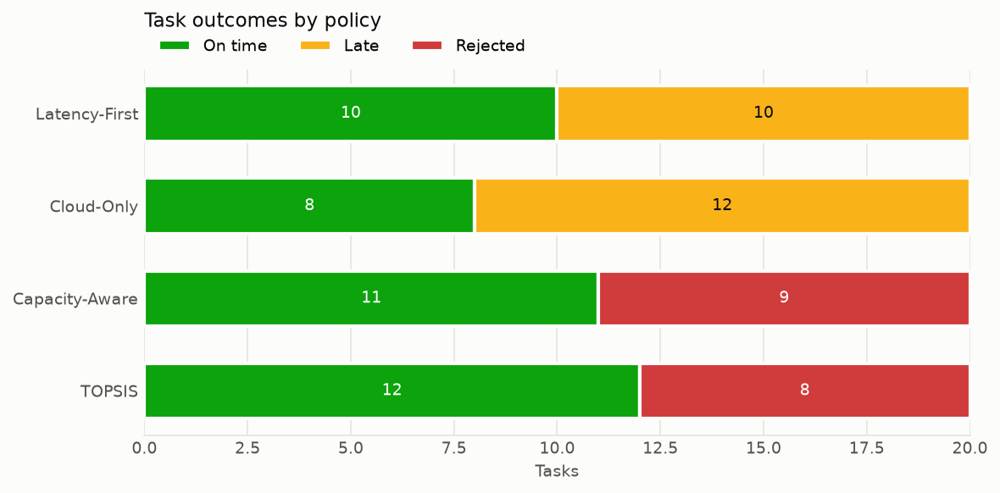
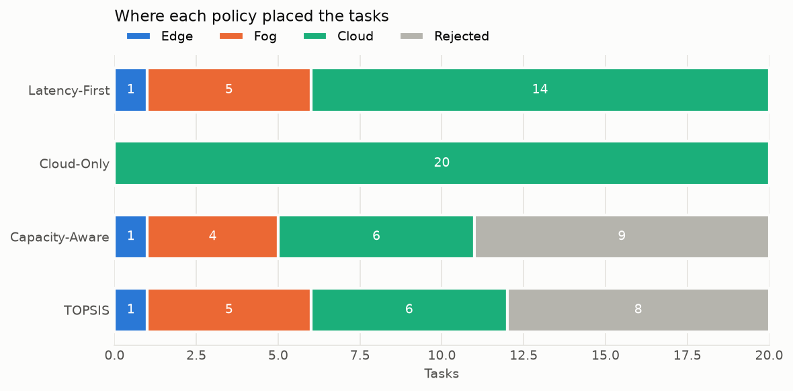
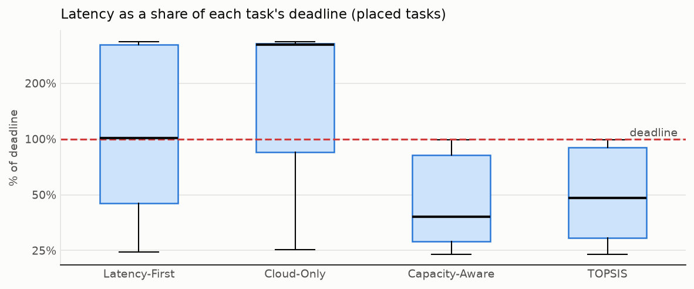
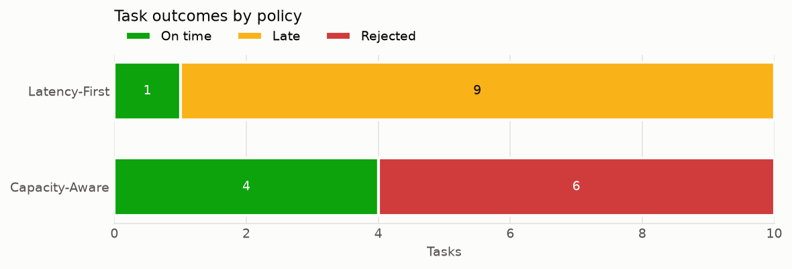
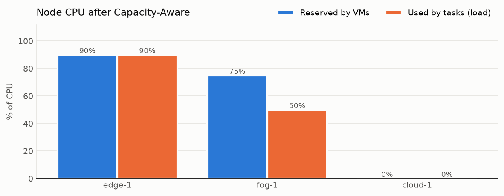
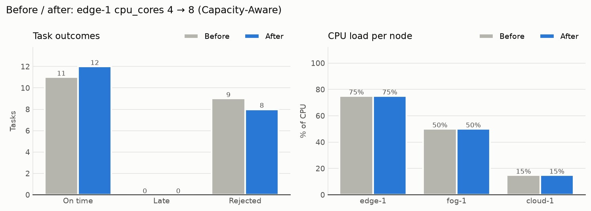
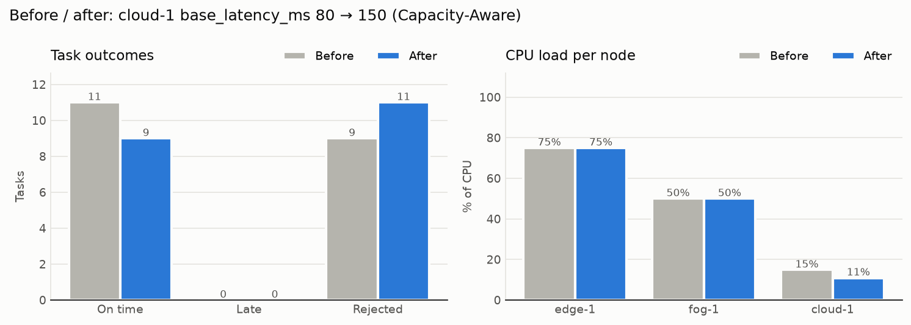

# EdgeFogSim experiments

Generated in `experiments/`. Re-run with `python run_experiments.py`; the exact settings are in [settings_used.json](settings_used.json).

| Experiment | Result | Checks held |
|---|---|---|
| E1 Policy comparison | ✅ as expected | 4 / 4 |
| E2 Overload | ✅ as expected | 5 / 5 |
| E3 Unauthorised tenant access | ✅ as expected | 4 / 4 |
| E4 Node capacity and latency change | ✅ as expected | 6 / 6 |

## E1: Policy comparison

**Setup**

- Workload: 20 generated tasks, seed 42 (11 high, 5 medium, 4 low sensitivity).
- Policies: Latency-First, Cloud-Only, Capacity-Aware, TOPSIS
- Each policy starts from empty nodes, so the comparison is fair.

**Expected outcome**

The smart policies (Capacity-Aware, TOPSIS) place no task late, and get more tasks on time than both baselines (Latency-First, Cloud-Only), which ignore deadlines.

**Actual outcome**


| Policy | On time | Late | Rejected | Offloaded | Success | Avg ms | P95 ms |
|---|---|---|---|---|---|---|---|
| Latency-First | 10 | 10 | 0 | 0 | 50% | 73.6 | 114.8 |
| Cloud-Only | 8 | 12 | 0 | 16 | 40% | 91.1 | 118.5 |
| Capacity-Aware | 11 | 0 | 9 | 3 | 55% | 70.9 | 120.3 |
| TOPSIS | 12 | 0 | 8 | 4 | 60% | 67.8 | 120.3 |







**Expected vs actual**

- ✅ Capacity-Aware places no task late (0 late)
- ✅ Capacity-Aware gets more tasks on time (11) than the best baseline (10)
- ✅ TOPSIS places no task late (0 late)
- ✅ TOPSIS gets more tasks on time (12) than the best baseline (10)

**Evidence**

- [E1/comparison.csv](E1/comparison.csv)
- [E1/comparison.json](E1/comparison.json)
- [E1/outcomes.png](E1/outcomes.png)
- [E1/tiers.png](E1/tiers.png)
- [E1/latency.png](E1/latency.png)

## E2: Overload

**Setup**

- Workload: 10 generated tasks, seed 7 (10 high sensitivity).
- Before the burst: edge-1 already 90% busy
- Policies: Latency-First, Capacity-Aware

**Expected outcome**

Capacity-Aware moves tasks that don't fit on the busy Edge node to another node (offloaded) and rejects, with a reason, tasks that no node can finish in time. It runs nothing late, never allocates more than a node has, and does better than Latency-First, which keeps placing tasks where they will be late.

**Actual outcome**


| Policy | On time | Late | Rejected | Offloaded | Success | Avg ms | P95 ms |
|---|---|---|---|---|---|---|---|
| Latency-First | 1 | 9 | 0 | 0 | 10% | 46.4 | 82.1 |
| Capacity-Aware | 4 | 0 | 6 | 4 | 40% | 24.1 | 24.9 |

Example offload (T02 → fog-1):
> offloaded to fog: edge-1 not enough CPU for a new VM (needs 2, 0.4 unreserved); best score on fog-1 (fog, preference 2 of 3); est. 24.6 ms ≤ 25 ms deadline; scores: fog-1 0.43; runs in new VM vm-0001 (4 CPU / 8 GB)

Example rejection (T01):
> no node passes: edge-1 not enough CPU for a new VM (needs 2, 0.4 unreserved); fog-1 too slow (est. 25.3 ms > 25 ms deadline); cloud-1 too slow (est. 82.5 ms > 25 ms deadline)





**Expected vs actual**

- ✅ Capacity-Aware offloads at least one task (4 offloaded)
- ✅ Capacity-Aware rejects tasks no node can serve in time (6 rejected, each with a reason)
- ✅ Capacity-Aware places no task late (0 late)
- ✅ No node is ever allocated beyond its capacity
- ✅ Capacity-Aware gets at least as many tasks on time (4) as Latency-First (1, with 9 late)

**Evidence**

- [E2/decisions_latency.csv](E2/decisions_latency.csv)
- [E2/decisions_capacity.csv](E2/decisions_capacity.csv)
- [E2/outcomes.png](E2/outcomes.png)
- [E2/node_usage.png](E2/node_usage.png)

## E3: Unauthorised tenant access

**Setup**

- Workload: 10 tasks from tasks_sample.csv.
- Placed with Capacity-Aware.
- Logged in as hospital-b, who tries to read hospital-a's task T01, read its VM vm-0001, and stop that VM. Then the admin reads the same records.

**Expected outcome**

Every attempt by hospital-b is refused with ACCESS DENIED, returns nothing, and adds one line to the audit log. hospital-a's VM keeps running. The admin can read both records.

**Actual outcome**

```
hospital-b → read task T01: ACCESS DENIED: hospital-b may not access task T01 (belongs to hospital-a)
hospital-b → read VM vm-0001: ACCESS DENIED: hospital-b may not access VM vm-0001 (belongs to hospital-a)
hospital-b → stop VM vm-0001: ACCESS DENIED: hospital-b may not access VM vm-0001 (belongs to hospital-a)
admin → read task T01 and VM vm-0001: allowed
```

*Audit log*

| timestamp | actor | target_tenant | resource | outcome |
|---|---|---|---|---|
| 2026-11-03T22:14:51 | hospital-b | hospital-a | task T01 | DENIED |
| 2026-11-03T22:14:51 | hospital-b | hospital-a | VM vm-0001 | DENIED |
| 2026-11-03T22:14:51 | hospital-b | hospital-a | VM vm-0001 | DENIED |

**Expected vs actual**

- ✅ All 3 attempts by hospital-b were refused (3 refused)
- ✅ The audit log has one line per refusal (3 lines)
- ✅ hospital-a's VM vm-0001 is still running
- ✅ The admin can read both records

**Evidence**

- [E3/access_attempts.txt](E3/access_attempts.txt)
- [E3/audit.log](E3/audit.log)

## E4: Node capacity and latency change

**Setup**

- Workload: 20 generated tasks, seed 42 (11 high, 5 medium, 4 low sensitivity).
- Policy: Capacity-Aware
- Each change is compared with the original nodes, one at a time.

**Expected outcome**

More CPU on a node lets it take more tasks, so at least as many finish on time and no more are rejected. More network latency on a node makes every task placed there slower; tasks whose deadline no longer allows that node move elsewhere or are rejected, while low-sensitivity tasks still finish on time.

**Actual outcome**


*Change a: edge-1 cpu_cores 4 → 8*

| Metric | Before | After |
|---|---|---|
| on time | 11 | 12 |
| late | 0 | 0 |
| rejected | 9 | 8 |
| offloaded | 3 | 3 |
| avg latency ms | 70.9 | 65.3 |
| p95 latency ms | 120.3 | 120.3 |
| tasks on edge | 1 | 2 |
| tasks on fog | 4 | 4 |
| tasks on cloud | 6 | 6 |



*Change b: cloud-1 base_latency_ms 80 → 150*

| Metric | Before | After |
|---|---|---|
| on time | 11 | 9 |
| late | 0 | 0 |
| rejected | 9 | 11 |
| offloaded | 3 | 1 |
| avg latency ms | 70.9 | 96.6 |
| p95 latency ms | 120.3 | 189.6 |
| tasks on edge | 1 | 1 |
| tasks on fog | 4 | 4 |
| tasks on cloud | 6 | 4 |



**Expected vs actual**

- ✅ edge-1 takes at least as many tasks (1 → 2)
- ✅ At least as many tasks on time (11 → 12)
- ✅ No more tasks rejected (9 → 8)
- ✅ Tasks on cloud-1 are slower on average (104 → 179 ms)
- ✅ Low-sensitivity tasks all still finish on time (4 / 4)
- ✅ No task runs late (late 0 → 0)

**Evidence**

- [E4/a/before_after.csv](E4/a/before_after.csv)
- [E4/a/before_after.png](E4/a/before_after.png)
- [E4/a/decisions_before.csv](E4/a/decisions_before.csv)
- [E4/a/decisions_after.csv](E4/a/decisions_after.csv)
- [E4/b/before_after.csv](E4/b/before_after.csv)
- [E4/b/before_after.png](E4/b/before_after.png)
- [E4/b/decisions_before.csv](E4/b/decisions_before.csv)
- [E4/b/decisions_after.csv](E4/b/decisions_after.csv)
